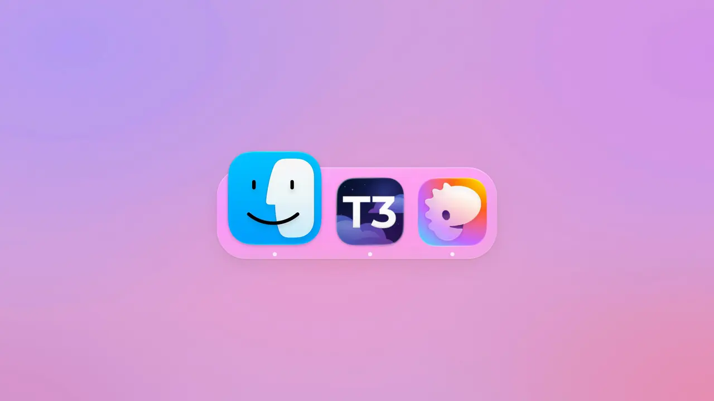
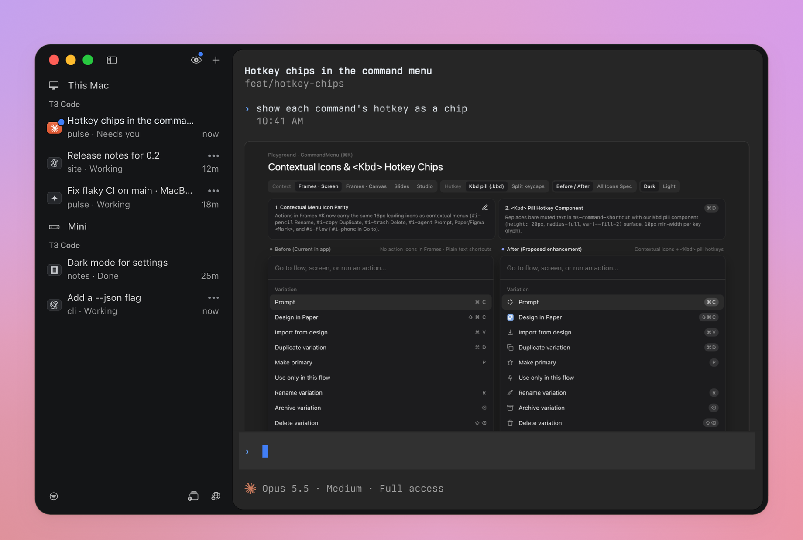

# tr3x

Your [T3 Code](https://github.com/pingdotgg/t3code) threads, as tabs in [Rex](https://www.superlogical.com/rex).

<a href="docs/assets/tr3x.mp4"></a>

T3 runs the agents. Rex is where you read and reply. Each open thread is a tab in one Rex
session, **T3 Code**, sorted like T3's sidebar: whatever needs you on top. tr3x runs no agent of
its own: every message, approval and setting goes to T3.



## What it does

- **One tab per thread.** Approvals, questions, failures and unread results first, then the
  inbox, then whatever's working.
- **Reply where you read.** One input under the conversation, with T3's model, effort and access
  chips. Approvals and questions are buttons: one click, or one tap on a phone.
- **A real terminal.** Rex's scrollback, find, selection and links all work. Markdown, tables,
  code, pictures and HTML previews render inline.
- **Rex's markers are T3's.** A tab's dot and label show what its thread waits on: `●` approval,
  `?` question, `✕` failed, `✓` done.
- **Every machine.** Threads from each machine you run T3 on share one session, in one order.
- **Any screen.** Rex's Mac and iPhone apps watch the same session. **Fit to This Device** sizes
  it to the one you're on.
- **Usage limits.** A thread stopped on its limit says when it resets. Reply shows what's left.
- **Pull requests.** `/pr create` commits, pushes and opens one; `/pr` shows it in a drawer.
- **Updates itself.** tr3x updates in the background, and `/update` updates T3 on any machine.

## Install

| | |
| --- | --- |
| **Needs** | A Mac or Linux machine, [Rex](https://www.superlogical.com/rex) (Rex Beta on a Mac), T3 Code running with at least one project |
| **Optional** | Chrome or Chromium for HTML previews; [sup](https://github.com/superultrainc/sup) for pull requests, which the drawer offers to add |

```sh
curl -fsSL https://raw.githubusercontent.com/macnason/tr3x/master/install.sh | sh
```

- Downloads the latest release, checks its SHA-256 and installs `~/.local/bin/tr3x`.
- Adds tr3x's actions and keys to Rex's config and switches Rex to **T3 Code**. Sync runs
  whenever Rex does.
- Pairs this machine's T3, then offers the other machines on your tailnet that run T3.
- On a Mac it opens Rex and T3 Code if they aren't running. On Linux it runs Rex's server as a
  service.

`tr3x doctor` checks each part and says how to fix it. `tr3x uninstall` undoes
[every step](docs/how-it-works.md#install-in-detail). `tr3x updates notify` or `off` stops
automatic updates. From a clone, `sh install.sh` builds with cargo instead.

## Getting started

| To | Do |
| --- | --- |
| See your threads | Open Rex. The **T3 Code** session has a tab per open thread. |
| Start a thread | ⌘T in the session, or ⌃⌘N anywhere. The chips pick project, model and worktree. |
| Reply | Type under the conversation, Enter. `/` lists commands and the agent's skills. |
| Answer an approval | Click **Approve**, **Always** or **Decline**, or type `a`, `s` or `d`. |
| Jump to what needs you | ⌃⌘I, on any machine. |
| Settle a thread | Close its tab. **Find Thread…** (⌘⇧P) brings it back. |

## More machines

- **An always-on host.** Agents stop when their T3 quits. Run T3 as a service
  (`t3 service install`) on a Linux box or a Mac you leave on, and install tr3x there. It prints
  the `rex hosts add` command for your other devices, which then need only Rex.
  [Choosing the host](docs/hosting.md) has the rest.
- **Another machine.** `tr3x pair` finds the machines on your tailnet that run T3 and pairs each.
- **Your phone.** Rex for iPhone shows the same session. Run **Fit to This Device** there.

## Let your agent drive it

tr3x comes with a [skill](skills/tr3x/SKILL.md) for coding agents: install and check tr3x, fix a
missing tab, pair a machine, change a setting, or settle, snooze and rename threads.

```sh
npx skills add macnason/tr3x
```

## Docs

- [Using tr3x](docs/usage.md): every key, command and setting, and known limits.
- [Choosing the host](docs/hosting.md): which machine runs Rex and sync, and moving it.
- [How it works](docs/how-it-works.md): sync, pairing, the panes, and install in detail.
- [Contributing](CONTRIBUTING.md): building, testing, and clean screenshots.
- [Security](SECURITY.md): what tr3x can reach, where its tokens live, and reporting a problem.

Works with T3 Code 0.1.6 and its nightlies (orchestration protocol 2), and Rex Beta 0.1.0. A
[daily check](.github/workflows/surface.yml) flags what each T3 nightly changes.

## Credits

- [Rex](https://www.superlogical.com/rex) by Superlogical.
- [T3 Code](https://github.com/pingdotgg/t3code) by Ping, which does the actual work.
- [sup](https://github.com/superultrainc/sup) by SuperUltra, which reviews and merges pull
  requests in the drawer.
- [t3term](https://github.com/krishhgg/t3term) by krishhgg (MIT), which tr3x's T3 client
  started from.

tr3x is an independent project. It isn't affiliated with Superlogical, Ping or SuperUltra.

## License

[MIT](LICENSE), by Mac ([macnason](https://github.com/macnason)). `t3client` keeps t3term's
[MIT license](t3client/LICENSE).
